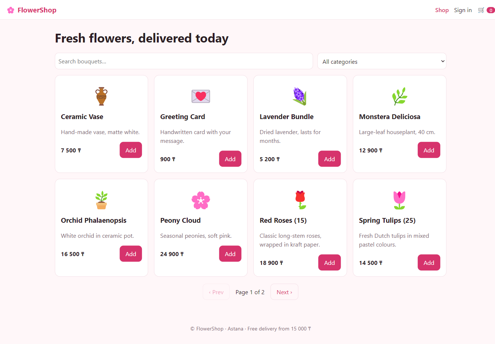
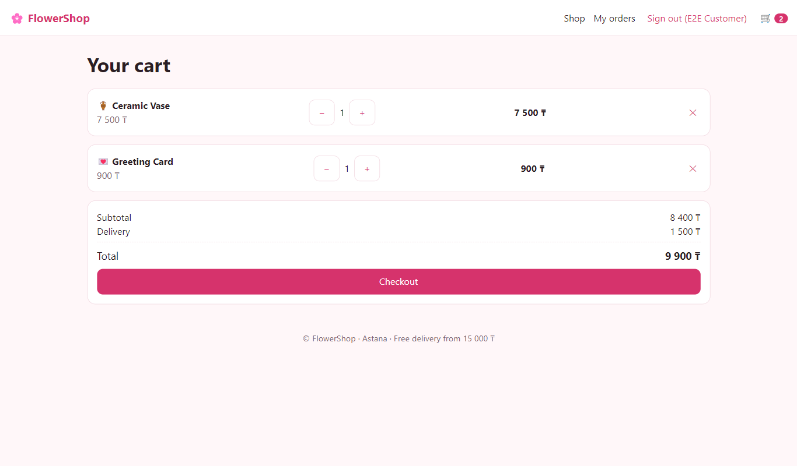
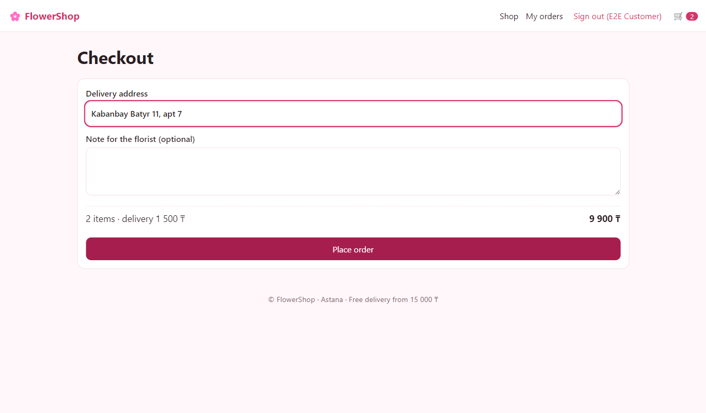
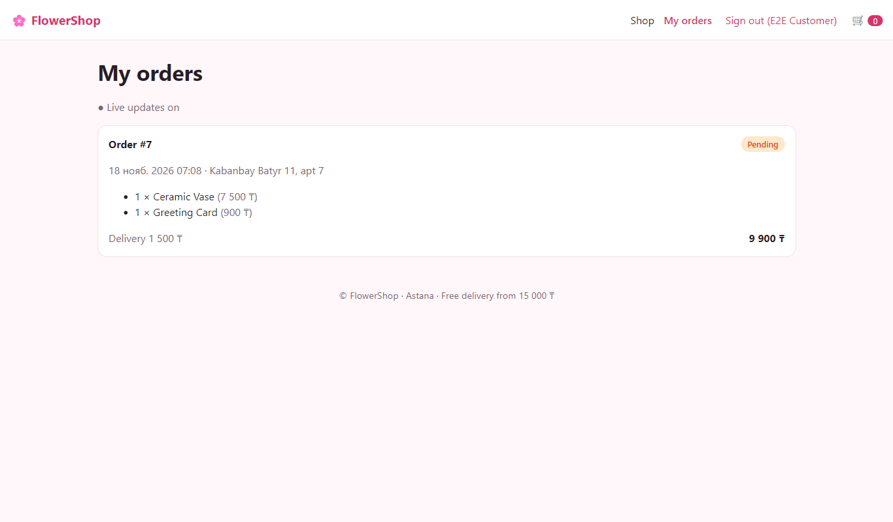
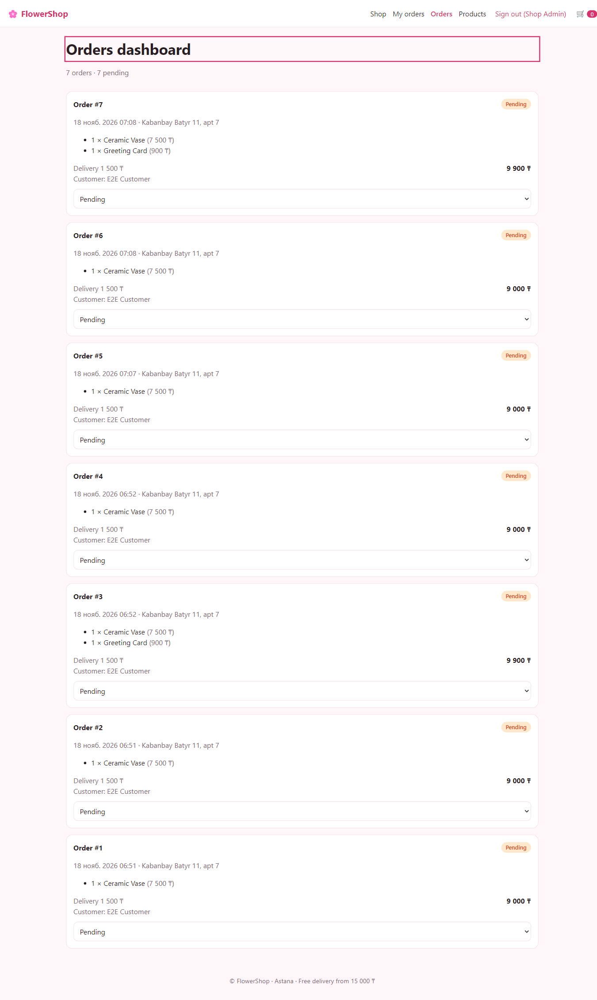
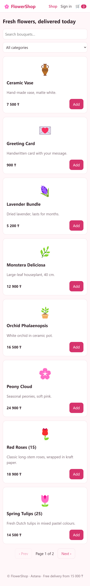
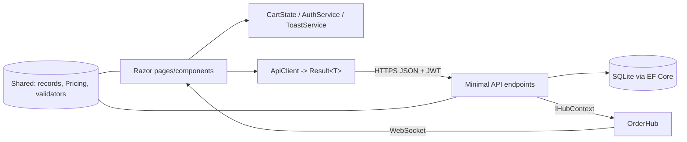
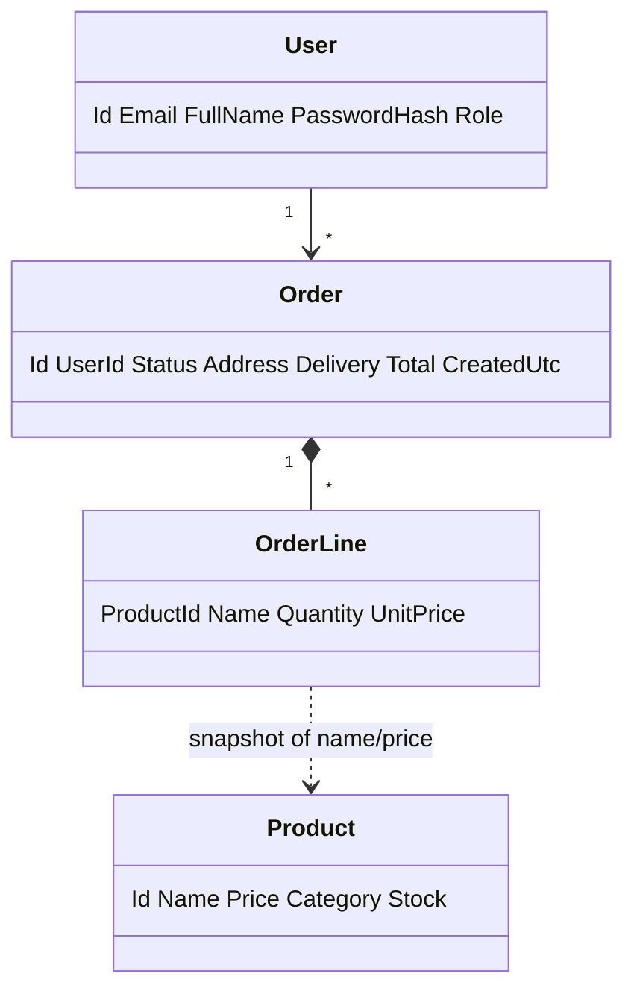
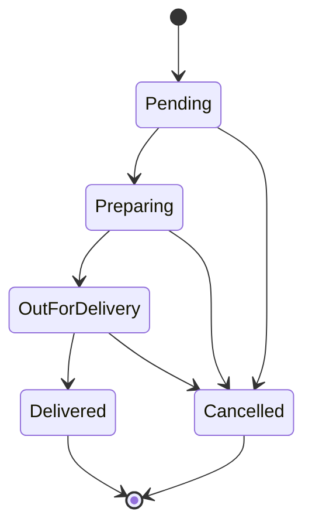

# 🌸 FlowerShop — Blazor WebAssembly + ASP.NET Core

Online flower shop for Astana: catalog with search/filter/paging, cart, checkout, **real-time order tracking (SignalR)**,
JWT auth with **role-based access** (Customer / Admin), admin dashboard, installable **PWA**.

## 1. Installation
Requirements: **.NET 8 SDK** (`dotnet --version` ≥ 8.0).

```bash
dotnet restore FlowerShop.sln
dotnet run --project src/FlowerShop.Server      # then open http://localhost:5000
dotnet test tests/FlowerShop.Tests               # 90+ automated tests (unit, integration, component)
dotnet test --collect:"XPlat Code Coverage"      # coverage report (coverlet)
```
**Browser E2E tests (Playwright):**
```bash
dotnet build tests/FlowerShop.E2E
powershell -ExecutionPolicy Bypass -File tests\FlowerShop.E2E\bin\Debug\net8.0\playwright.ps1 install   # once: downloads Chromium, Firefox and WebKit
# terminal 1: dotnet run --project src/FlowerShop.Server --environment Development
# terminal 2: dotnet test tests/FlowerShop.E2E       (set HEADED=1 to watch the browser)
# another port:  dotnet run ... --urls http://localhost:5050   and   $env:BASE_URL="http://localhost:5050"
```
> **WebKit on Windows:** Playwright's Windows build of WebKit cannot run Blazor WebAssembly, so on Windows the two WebKit-only tests are *skipped*
> and the Apple-device tests (iPhone 13, iPad Pro 11, Desktop Safari) are emulated in Chromium (same viewport, touch, user agent).
> Real WebKit runs on Linux/macOS/WSL and in CI (`.github/workflows/ci.yml`). `FORCE_WEBKIT=1` forces WebKit on Windows.

**Open on a phone (same Wi-Fi):** `dotnet run --project src/FlowerShop.Server --urls http://0.0.0.0:5000`, find the PC address with `ipconfig`, open `http://<PC-IP>:5000` (allow Windows Firewall for private networks).

**Docker (deployment):**
```bash
JWT_KEY=<32+ random chars> ADMIN_PASSWORD=<strong password> docker compose up --build    # http://localhost:8080
```
Data lives in the `flowershop-data` volume; `GET /health` is the liveness probe. With `ASPNETCORE_ENVIRONMENT=Production` the server refuses to start with the placeholder JWT key.
API documentation (Swagger UI): `http://localhost:5000/swagger`. Production build: `dotnet publish src/FlowerShop.Server -c Release`.

If `FlowerShop.sln` fails to load in your IDE, recreate it: `dotnet new sln -n FlowerShop && dotnet sln add src/*/*.csproj tests/*/*.csproj`.

Demo accounts — Admin: `admin@flowershop.kz` / `Admin12345` (change in `appsettings.json` → `Seed`). Customers register themselves.
Production: set `Jwt__Key` (32+ chars) via environment variable / user-secrets, plus `Seed__AdminEmail` / `Seed__AdminPassword`.
The key and admin password in `appsettings.json` are **development-only placeholders** for the demo.

### Screenshots
Generated by the E2E test `Capture_screenshots_for_presentation` into `docs/screenshots`:

| Catalog | Cart | Checkout |
|---|---|---|
|  |  |  |

| My orders | Admin orders | Mobile (iPhone 13) |
|---|---|---|
|  |  |  |

## 2. User guide
**Customer:** browse → search/filter → *Add* → cart (+/−) → *Checkout* (sign in/register) → enter address → *Place order* → **My orders** shows status and updates live.
**Admin:** *Orders* tab → all orders (virtualized list) → change status via dropdown (only the **next valid step** or *Cancelled* is offered) → customer sees it instantly; new orders pop up as toasts. *Products* tab → add / edit / delete products.
Cancelling an order returns its items to stock. *Delivered* and *Cancelled* are final.
Free delivery from 15 000 ₸, otherwise 1 500 ₸.

## 3. Architecture
```
FlowerShop.Shared   pure C#: records (DTOs), Result<T>, Pricing, validators, CartOps   ← functional core
FlowerShop.Server   ASP.NET Core minimal API + EF Core (SQLite) + JWT + SignalR hub     ← imperative shell
FlowerShop.UI       Razor class library: reusable components, state container (CartState), API client, auth/hub services
FlowerShop.Client   Blazor WASM PWA host: public pages, layout, routing + lazy-loading of the admin assembly
FlowerShop.Admin    Razor class library with the admin pages — downloaded ONLY when someone opens /admin (lazy loading)
FlowerShop.Tests    xUnit unit + integration (WebApplicationFactory) + bUnit component tests
```


Pattern: **functional core / imperative shell** (pure functions in Shared, side-effects at the edges), **state container** (`CartState`), **Repository-free EF Core** (DbContext as unit of work), **Result pattern** instead of exceptions for expected failures.

### 3.1 Functional programming approach
The project applies functional-programming principles in C# (records, LINQ, pattern matching):
| FP principle | Where |
|---|---|
| **Pure functions** (no I/O, no hidden state, same input → same output) | `Pricing`, `OrderValidator`, `AuthValidator`, `CartOps`, `OrderWorkflow` in `Shared/Logic.cs`; unit-tested without mocks |
| **Immutability** | DTOs are `record`s; updates use non-destructive `with`; `CartState.Lines` is an `IReadOnlyList` replaced, never mutated |
| **Errors as values** | `Result<T>` with `Map` / `Bind` / `Match` (railway-oriented) instead of exceptions for expected failures |
| **State machine as data** | `OrderWorkflow.Next(status)` is a pattern-matching function; the server enforces it, the admin UI renders from it |
| **Functional core, imperative shell** | pure logic in `Shared`; DB, HTTP, SignalR and browser storage only at the edges (`Server`, `UI`) |
| **Same code on client and server** | one pricing/validation implementation compiled into both the WASM client and the API (client previews, server decides) |
| **Declarative transformation** | LINQ pipelines (`Select`, `Where`, `GroupBy`, `Sum`), collection expressions, pattern matching |
| **Higher-order functions / composition** | `Result.Bind(f)`, `RenderFragment<T>` templates (`DataList<TItem>`), `EventCallback` parameters |



## 4. API (all under `/api`)
| Method | Route | Auth | Notes |
|---|---|---|---|
| POST | `/auth/register`, `/auth/login` | – | rate-limited, returns JWT |
| GET | `/products?category&search&page&pageSize` | – | output-cached 30 s, tag-evicted on change |
| GET | `/categories` | – | cached |
| POST/PUT/DELETE | `/products[/{id}]` | Admin | |
| POST | `/orders` | user | price+stock checked server-side, transactional, 409 on stock conflict |
| GET | `/orders/mine` | user | |
| GET | `/orders` | Admin | |
| PUT | `/orders/{id}/status` | Admin | follows the `OrderWorkflow` state machine (409 otherwise); cancelling restores stock; pushes `OrderStatusChanged` to the customer |
| GET | `/health` | – | liveness probe (outside `/api`) |
Interactive docs: **Swagger UI** at `/swagger` (with JWT "Authorize" button). SignalR hub: `/hubs/orders` (events `OrderStatusChanged`, `NewOrder`). Errors are RFC 7807 ProblemDetails.

## 5. Mapping to the 20 grading criteria
| # | Criterion | Where it is shown |
|---|---|---|
| 1 Code structure | 5-project clean split, functional core in `Shared/Logic.cs`, `Result<T>` |
| 2 Reusability | `ProductCard`, `OrderCard`, `StatusBadge`, **templated** `DataList<TItem>`, `[Parameter]`, `EventCallback` |
| 3 Cross-platform | Blazor WASM = any OS/browser; PWA manifest + service worker; no OS-specific code; CI runs the tests on **Windows, macOS and Linux**; E2E on Chromium/Firefox/WebKit + 6 device profiles (WebKit on Linux/CI, see §6) |
| 4 State management | `CartState` container + `CascadingValue` (layout) + `CascadingAuthenticationState`; immutable updates |
| 5 UI design | CSS variables, light/dark theme, consistent cards/buttons, skeleton loaders |
| 6 UX | toasts, retry buttons, empty states, skip-link, focus management, ARIA labels, 44 px targets |
| 7 Responsiveness | grid `auto-fill`, 3 breakpoints, `viewport-fit=cover`, reduced-motion |
| 8 Core functionality | catalog, cart, checkout, orders, auth, admin |
| 9 Advanced features | **SignalR** live updates, **JWT + RBAC**, rate limiting, optimistic concurrency, **order state machine** with stock restoration on cancel, PWA, security headers, health endpoint |
| 10 Error handling | global exception handler → ProblemDetails, `Result<T>` in client, 401 auto sign-out, retry UI, safe storage |
| 11 Efficiency | Brotli-compressed WASM (`BlazorEnableCompression`) + IL trimming on Release publish, response compression, output cache, `AsNoTracking`, `Virtualize`, debounced search, SignalR connection opened **lazily** (only on Orders/Admin pages). **Route-level lazy loading**: the admin pages live in a separate assembly (`FlowerShop.Admin.wasm`) fetched by `LazyAssemblyLoader` only on the first visit to `/admin` — customers never download it (proven by an E2E test that watches network requests) |
| 12 Scalability | stateless API + JWT (scale-out ready), paging, indexes, DB swappable (change provider to PostgreSQL) |
| 13 Resource use | request cancellation (`CancellationTokenSource`), debounce, cache, hub reconnect only when logged in |
| 14 Testing | 90+ unit (pricing, validators, cart, workflow, `Result`, JWT parsing, hashing), integration (`WebApplicationFactory`: order flow, workflow 409, stock restore, health, headers) and bUnit component tests + 16 **Playwright E2E** cases in **Chromium, Firefox and WebKit**; coverage reported by CI (§6.3) |
| 15 QA | §6: automated cross-browser/device matrix + manual checklist with results (`docs/QA-report.md`) |
| 16 Documentation | this README (install, user guide, architecture diagrams) + **Swagger/OpenAPI** API docs |
| 17 Innovation | live order tracking, server-authoritative pricing, offline-capable shell, dark mode |
| 18 Creative .NET use | templated components, minimal APIs, output-cache tags, `IHubContext`, records + `with`, collection expressions |
| 19 Professionalism | secrets via config (Production refuses the dev key), PBKDF2 hashing, validation on both sides, consistent errors, security headers, **Dockerfile + compose**, **GitHub Actions CI**, `docs/DEVELOPER.md` |
| 20 Presentation | outline below |

## 6. Quality assurance (cross-browser + cross-device)
### 6.1 Automated (repeatable: `dotnet test tests/FlowerShop.E2E` with the server running, or CI)
| What | How |
|---|---|
| Browsers | the same flows run in **Chromium (Chrome/Edge), Firefox and WebKit (Safari engine)** |
| Devices | **iPhone 13, Pixel 7, iPad Pro 11** + desktop Chrome/Firefox/Safari profiles: no horizontal scroll on catalog/cart/login, cart reachable, add-to-cart works |
| Operating systems | CI runs unit/integration/component tests on Windows, macOS and Linux |
| Security | a customer cannot open `/admin` (role check in the browser), admin API returns 403 for customers (integration test) |
| Real-time | second browser context: admin sees a new order instantly |
| Lazy loading | admin assembly is not requested until `/admin` is opened |
| Screenshots | `Capture_screenshots_for_presentation` writes 9 PNGs to `docs/screenshots` |

**Known limitation (documented, not hidden):** Playwright's WebKit for Windows cannot run Blazor WebAssembly. On Windows, WebKit-only tests are skipped and Apple devices are emulated in Chromium;
the full WebKit run is performed on Linux in GitHub Actions.

### 6.2 Latest local run (Windows, .NET 8, `dotnet test tests/FlowerShop.E2E`)
Total 16 · passed 14 · skipped 2 (WebKit-only on Windows) · failed 0 · 2 min 31 s.

### 6.3 Coverage, Lighthouse and manual QA
Coverage: `dotnet test tests/FlowerShop.Tests --collect:"XPlat Code Coverage"` (CI publishes the summary).
The manual checklist, device matrix and Lighthouse scores are recorded in **`docs/QA-report.md`**.

## 7. Presentation outline (8 slides)
1. Team (full names — see `docs/TEAM.md`), topic, aim, goals, plan/timeline
2. Analysis of existing technologies + comparison (Blazor WASM vs Blazor Server vs MAUI Blazor Hybrid vs React/Angular; EF Core vs Dapper; SignalR vs polling) — why Blazor WASM + PWA
3. Architecture (the two diagrams above)
4. Relevance / practical significance (small florists, same-day delivery, Astana market)
5. Methodology + mockups (screenshots of catalog, cart, admin)
6. Key technical decisions (functional core, Result<T>, server-authoritative pricing, concurrency)
7. Testing & QA results (test count, coverage %, Lighthouse)
8. Live demo + future work (payments, Kaspi Pay, courier map)

## 8. Likely defense questions
- *Why is the price calculated on the server?* Client data can be tampered with; server re-reads prices and recomputes.
- *What happens if two users buy the last item?* `Stock` is an EF concurrency token → second save throws `DbUpdateConcurrencyException` → 409 with a clear message.
- *How is the password stored?* PBKDF2-SHA256, 100k iterations, random 16-byte salt, constant-time compare.
- *Why `Result<T>`?* Expected failures are values, not exceptions; pages stay simple and testable.
- *How does live update work?* Server pushes through SignalR groups (`user-{id}`, `admins`); JWT travels in the query string only for `/hubs`.
- *Where is the functional programming?* §3.1: pure `Shared` core, immutable records, `Result<T>` with `Bind`/`Map`, `OrderWorkflow` state machine, functional core / imperative shell.
- *Can an admin jump an order from Pending to Delivered?* No: `OrderWorkflow.CanMove` is enforced on the server (409) and the UI only offers valid next steps; cancelling returns stock.
- *How would you scale?* Stateless API behind a load balancer, Redis backplane for SignalR, PostgreSQL instead of SQLite.
Each of you must be able to explain **every** part (the defense asks any member about any part).
